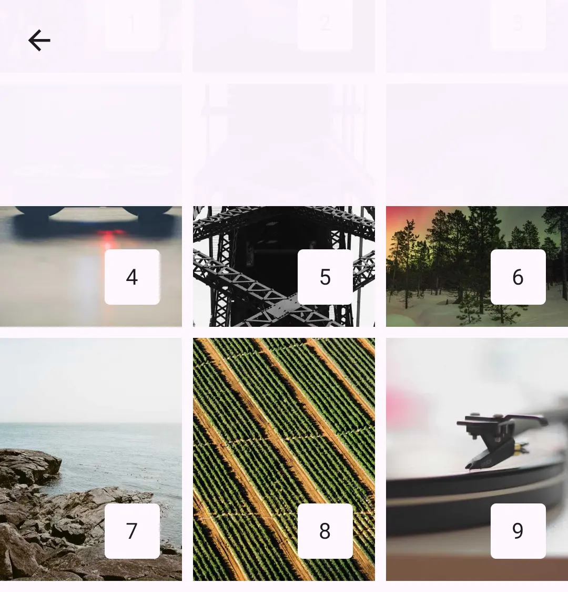

Haze works on every platform [Compose Multiplatform](https://www.jetbrains.com/compose-multiplatform/) supports: Android, iOS, macOS, Desktop (JVM), and Web (Wasm and JS).

!!! note "Compose Multiplatform platforms"

    Compose Multiplatform supports fewer platforms than Kotlin Multiplatform. Haze can only support a platform once Compose Multiplatform does.

## Android

Haze supports Android 6.0 (API 23) and newer.

### Android 13+

SDK Levels: 33+

All features are fully supported.

### Android 12 & 12L

SDK Levels: 31 & 32

Blur is enabled by default, with these differences:

#### HazeProgressive

With a full-resolution performance mode, such as [HazePerformanceMode.Quality](../api/haze/dev.chrisbanes.haze/-haze-performance-mode/-companion/-quality.html), linear [HazeProgressive](../api/haze/dev.chrisbanes.haze/-haze-progressive/index.html) effects are drawn several times. This costs more, so measure it for your workload.

Lower-resolution modes, such as [HazePerformanceMode.Balanced](../api/haze/dev.chrisbanes.haze/-haze-performance-mode/-companion/-balanced.html), and all non-linear progressive types use a gradient mask instead. This blends between blurred and unblurred content rather than varying the blur strength.

#### Extra redraws

On Android 12 (API 31) and below, Haze redraws Blur more often than strictly necessary so that it stays in sync with the content behind it. This should not cause noticeable performance issues, but you can [disable Blur](usage.md#enabling-blur) if needed.

### Android 11 and below

SDK Levels: 30 and below

Blur is disabled by default. Haze draws a translucent scrim instead:

#### RenderScript blurring

You can [enable Blur](usage.md#enabling-blur) on these versions, which uses [RenderScript](https://developer.android.com/guide/topics/renderscript/compute).

!!! warning "Experimental"

    Blur on Android 11 and below is experimental. It may become the default in a future release, or be removed if it proves unstable. Please raise issues if you find problems.

This path is slower than on Android 12 and newer. To avoid dropping frames, Haze blurs on a background thread and skips frames while it is busy, so the Blur usually trails content changes by a frame or more. It can look laggy when the content behind it changes quickly. Progressive Blur uses a gradient mask, as described above.

!!! info "Thanks"

    Big thanks to [Serhii Yaremych](https://github.com/desugar-64) for his help on this, as we have managed to get an optimized 'content write' working. 🚀

## Desktop

Desktop (JVM) is fully supported. See [Skiko platforms](#skiko).

## iOS

iOS is fully supported. See [Skiko platforms](#skiko).

## macOS

macOS is supported on Apple silicon (`macosArm64`). See [Skiko platforms](#skiko).

## Web

Web is fully supported on Kotlin/Wasm and Kotlin/JS. See [Skiko platforms](#skiko).

## Skiko

Desktop, iOS, macOS, and Web all render through [Skiko][skiko], which bundles the [Skia Graphics Library](https://skia.org) into your app. Blur behaves the same on all of them: every feature is supported and Blur is enabled by default.

Haze is built, tested, and released against the latest stable version of Compose Multiplatform.

### Using pre-release versions of Compose Multiplatform

We occasionally verify against pre-release versions of Compose Multiplatform, but don't guarantee compatibility. Test thoroughly if you use one.

 [skiko]: https://github.com/JetBrains/skiko
